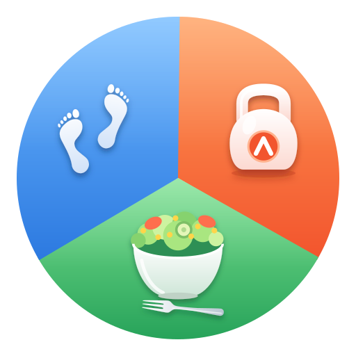
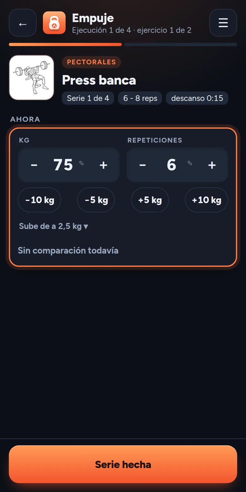
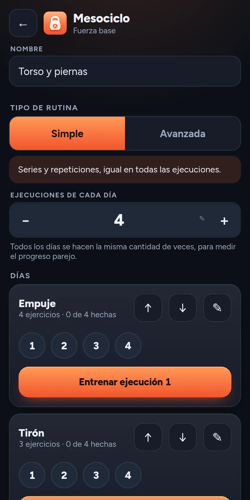
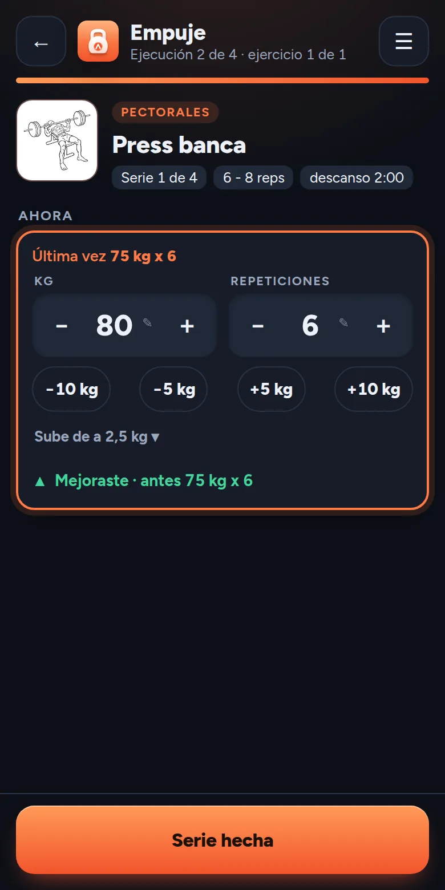
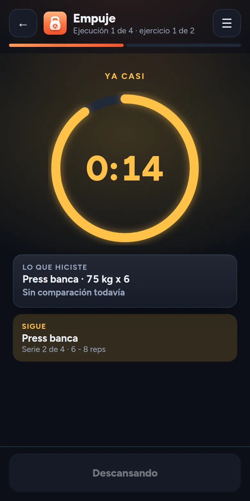
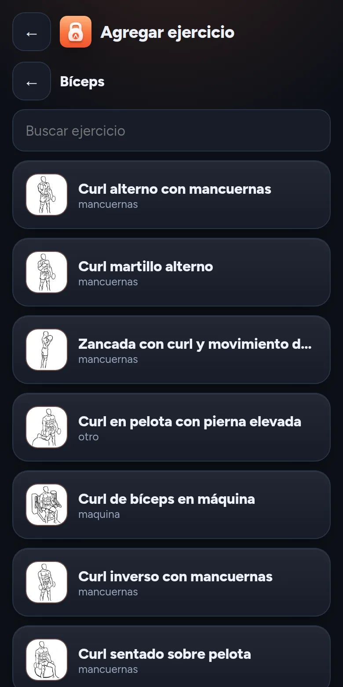
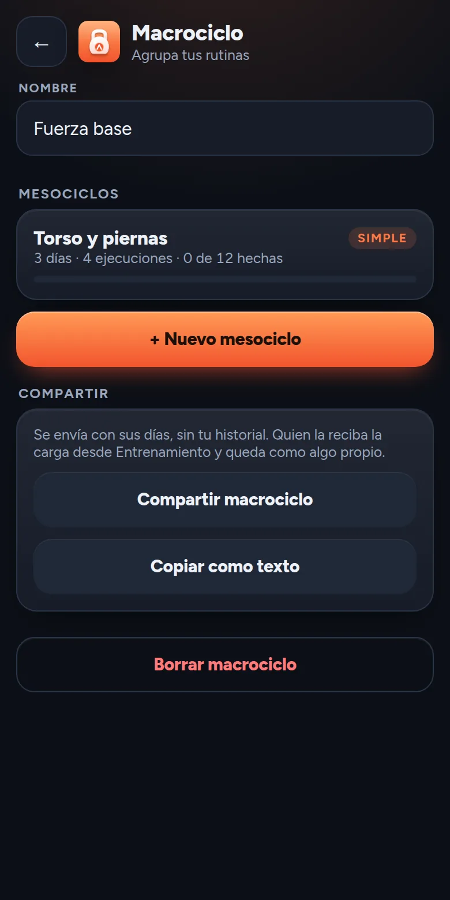

<p align="center">
  
</p>

<h1 align="center">MejorAndo</h1>

<p align="center">
  <strong>Tu rutina, sin papel y sin vueltas.</strong><br>
  Una app para planificar tus entrenamientos de fuerza, seguirlos serie por serie y ver si mejoraste respecto de la vez anterior.<br>
  Se instala en el celular y funciona sin conexión.
</p>

<p align="center">
  <a href="https://mdev-repos.github.io/mejorando/"><strong>Abrir la app</strong></a> ·
  <a href="https://mdev-repos.github.io/mejorando-landing/">Ver la página</a> ·
  <a href="https://mdev-repos.github.io/mejorando-landing/faq.html">Preguntas frecuentes</a> ·
  <a href="https://github.com/mdev-repos/mejorando">Código de la app</a>
</p>

<p align="center">
  
</p>

Este repositorio es la página de presentación de MejorAndo. Lo que sigue es la misma página en formato de texto, para leerla desde acá.

---

## Por qué existe

Bajé 20 kg en unos meses, estudiando mucho sobre entrenamiento y salud por mi cuenta, y adquiriendo buenas prácticas para lograr mis objetivos. Durante ese tiempo lo fui llevando todo "a mano", el progreso en el gimnasio con papel y bolígrafo, y la organización de la dieta y su progreso en hojas de cálculo. Esa forma de anotar fue lo que más me ayudó a mejorar mi manera de trabajar.

Es por ello que quise construir una app que recogiera aquello que hice en papel y en hojas de cálculo, para que otras personas también puedan conseguir sus objetivos.

*Matías*

Por eso es una app chica y hace pocas cosas. Las que hace tienen que servir mientras entrenás, entre una serie y otra, siendo una ayuda y no una molestia.

## Lo que ya hace

### Un plan en cuatro niveles

Un macrociclo agrupa mesociclos, cada mesociclo es una rutina con sus días y cada día se hace varias veces, que son las ejecuciones. Así podés medir tu progreso comparando la misma sesión a lo largo del tiempo. Una rutina avanzada suma JumpSet, rest pause y escalonado, y deja que cada ejecución sea distinta.

<p align="center"></p>

### Cada serie, contra la anterior

Al terminar una serie, la app te muestra lo que hiciste la última vez y te dice si mejoraste. Más peso cuenta como mejora y, con el mismo peso, más repeticiones también. Las series de aproximación se guardan aparte y no entran en la comparación. El resultado nunca depende solo del color, siempre viene con texto.

<p align="center"></p>

### Descansos que se respetan

El descanso lo define la rutina y el cronómetro no deja saltearlo, porque el descanso es tan importante como el peso y las repeticiones. Cuando se acerca el final cambia de color, a los 15 segundos pasa a amarillo, a los 10 a rojo y al terminar a verde. También suena y vibra, y cada aviso se puede apagar.

<p align="center"></p>

### Más de 240 ejercicios con dibujo

Elegís por grupo muscular y casi todos los ejercicios traen su ilustración. Si falta alguno, creás el tuyo. Cada ejercicio recuerda de cuánto en cuánto subís el peso. Los dibujos son del proyecto [Everkinetic](https://github.com/everkinetic/data), de Greg Priday, con licencia [CC BY-SA 4.0](https://creativecommons.org/licenses/by-sa/4.0/).

<p align="center"></p>

### Pasale tu rutina a otra persona

Armás un macrociclo una vez y se lo mandás a quien quieras, por el menú de compartir o como texto para pegar en un chat. Quien lo recibe lo carga y queda como algo suyo, sin tu historial y sin tocar lo que ya tenía.

<p align="center"></p>

### Y además

- **Sin cuenta.** Todo se guarda en tu teléfono. Podés guardar una copia de seguridad y restaurarla cuando quieras.
- **Sin conexión.** Se instala como una app y funciona en el gimnasio aunque no haya señal. Cuando hay una versión nueva, te avisa.
- **Claro u oscuro.** Sigue el tema de tu teléfono, o lo elegís vos.

## Instalala

**En Android.** Abrí [la app](https://mdev-repos.github.io/mejorando/) con Chrome. Tocá **Instalar** en la tarjeta de Inicio, o el menú de los tres puntos y **Instalar aplicación**. Queda en tu pantalla de inicio con su ícono.

**En iPhone.** Abrila con Safari, tocá **Compartir** y después **Agregar a inicio**. La probé en Android. En iPhone debería funcionar igual, pero no vibra y todavía no la probé ahí.

Con la pantalla bloqueada el celular puede no reproducir el sonido del descanso. Es una limitación de las apps que se instalan desde el navegador. Hay más respuestas en las [preguntas frecuentes](https://mdev-repos.github.io/mejorando-landing/faq.html).

## Lo que viene

| | |
|---|---|
| **Próximo** | Comparar ejecuciones y ver el progreso. La ejecución 2 contra la 1, y cómo evoluciona cada ejercicio con el tiempo |
| **Después** | AlimentAndo, con calorías, peso y medidas |
| **Después** | CaminAndo, con los pasos diarios y una meta recomendada |
| **Idea** | Una cuenta opcional para sincronizar, para usar la misma rutina en más de un teléfono |

## Para quien mira el código

Soy desarrollador backend y esta app es el proyecto donde recorrí todo lo demás, desde el diseño hasta la publicación. La armé en pareja con Claude, el asistente de Anthropic. Yo decido qué se hace y por qué, Claude escribe buena parte del código del frente, y cada decisión queda escrita.

| | |
|---|---|
| **Diseño y estética** | Identidad propia con nombre, logo de tres sectores y un color por módulo. Dos temas, tipografía Figtree y una paleta pensada para leerse bien en un gimnasio |
| **UX y UI** | Pensada para usarse con una mano y entre series. Botones grandes, números que se editan o se ajustan manteniendo apretado, y un descanso que avisa con color, sonido y vibración |
| **Arquitectura** | Aplicación web instalable que funciona sin conexión, con React, TypeScript y una base de datos local. Las reglas del entrenamiento viven separadas de las pantallas y los datos se migran entre versiones |
| **Decisiones escritas** | Cada elección importante tiene su registro, con el contexto, las alternativas y las consecuencias |
| **Pruebas** | Más de 60 pruebas automáticas sobre las reglas, la base de datos y las pantallas, con tipos estrictos y revisión automática en cada cambio |
| **Publicación** | Se despliega sola a cada cambio. Una versión nueva se avisa dentro de la app y se instala con un toque |

[Ver el código en GitHub](https://github.com/mdev-repos/mejorando) · [Leer las decisiones](https://github.com/mdev-repos/mejorando/tree/main/docs/decisiones)

**Matías Mazzitelli.** Desarrollador backend con Java y Spring Boot y mainframe IBM. [GitHub](https://github.com/mdev-repos)

## Probala

Es gratis, no pide registro y se instala en un minuto. **[Abrir la app](https://mdev-repos.github.io/mejorando/)**

¿Algo no funciona o se te ocurre una mejora? Contámelo en el [formulario de comentarios](https://forms.gle/BD4rLPc3CnRy8jAa6).

## Esta página

Es un sitio estático, sin pasos de construcción. Se puede abrir `index.html` o servir la carpeta, por ejemplo:

```bash
python3 -m http.server 5180
```

## Licencia y créditos

- **Código de la página.** [GPL 3.0 o posterior](LICENSE).
- **Dibujos de los ejercicios.** Del proyecto [Everkinetic](https://github.com/everkinetic/data), de Greg Priday, con licencia CC BY-SA 4.0. Se convirtieron a otro formato y tamaño, sin cambiar el dibujo.
- **Nombre y logo.** El nombre MejorAndo y su logo no están cubiertos por la licencia del código.
- **Tipografía.** Figtree, con licencia OFL.
